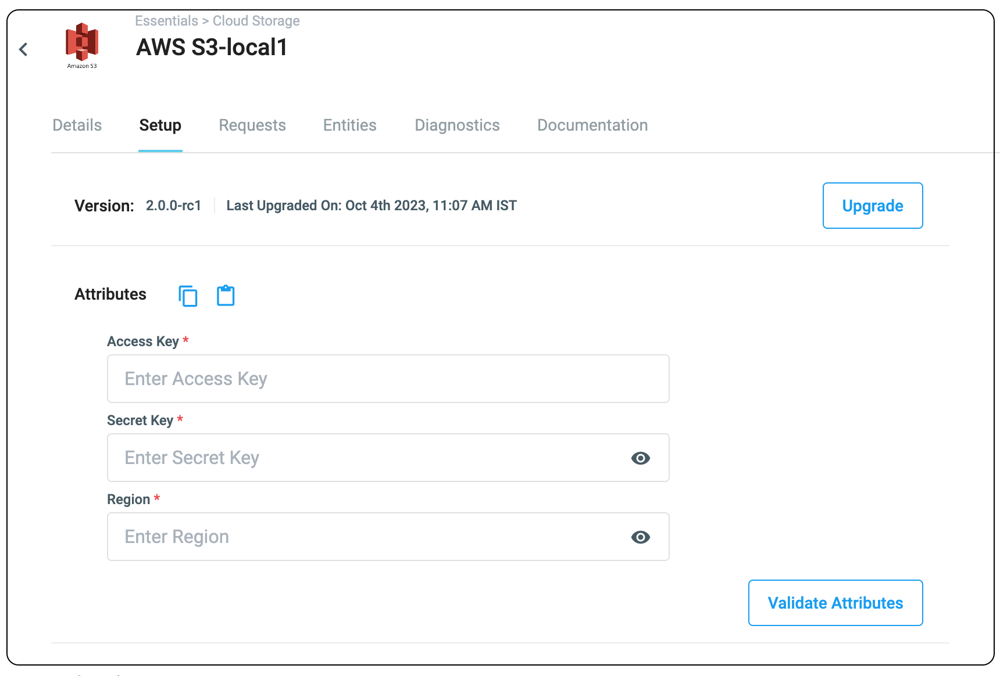

# Extension Configuration

## Overview

The AWS S3 Extension requires AWS credentials to authenticate and interact with your S3 buckets. This page provides
detailed information about the configuration parameters and step-by-step setup instructions.

## Configuration Parameters

| Parameter  | Type | Required | Description                                                     | Example                                    |
|------------|------|----------|-----------------------------------------------------------------|--------------------------------------------|
| Access Key | Text | Yes      | Your IAM user's Access Key ID for AWS authentication            | `REDACTED_SECRET`                     |
| Secret Key | Text | Yes      | Your IAM user's Secret Access Key for AWS authentication        | `wJalrXUtnFEMI/K7MDENG/bPxRfiCYEXAMPLEKEY` |
| Region     | Text | Yes      | AWS region where your S3 buckets are located or will be created | `us-east-1`                                |

## Step-by-Step Setup

### 1. Access the Extension Configuration

1. Navigate to the Krista platform
2. Go to **Extensions** section
3. Locate the **AWS S3 Extension**
4. Click on **Configure** or **Settings**

### 2. Enter Configuration Parameters



1. **Access Key**: Enter your IAM user's Access Key ID
    - This is a 20-character alphanumeric string
    - Example: `REDACTED_SECRET`
    - Obtain this from the AWS IAM console (see [Creating AWS User](/pages/CreatingAWSUser.md))

2. **Secret Key**: Enter your IAM user's Secret Access Key
    - This is a 40-character alphanumeric string
    - Example: `wJalrXUtnFEMI/K7MDENG/bPxRfiCYEXAMPLEKEY`
    - **Important**: This is only shown once when created. Store it securely.

3. **Region**: Specify the AWS region
    - Use the region code (e.g., `us-east-1`, `eu-west-1`, `ap-southeast-1`)
    - This determines where your buckets are located or will be created
    - See [AWS Regions List](https://docs.aws.amazon.com/general/latest/gr/rande.html#s3_region) for all available
      regions

### 3. Save Configuration

1. Click **Save** or **Apply** to store the configuration
2. The extension will validate the credentials
3. If successful, you'll see a confirmation message

### 4. Test the Connection

After configuration, test the connection to ensure everything is working:

1. Use a simple catalog request like **List File from Bucket**
2. Provide a valid bucket name
3. Verify that the extension can connect and retrieve data

## AWS Region Selection

Choose the region based on your requirements:

### Common AWS Regions

| Region Name              | Region Code      | Location      |
|--------------------------|------------------|---------------|
| US East (N. Virginia)    | `us-east-1`      | United States |
| US West (Oregon)         | `us-west-2`      | United States |
| EU (Ireland)             | `eu-west-1`      | Europe        |
| EU (Frankfurt)           | `eu-central-1`   | Europe        |
| Asia Pacific (Singapore) | `ap-southeast-1` | Asia          |
| Asia Pacific (Sydney)    | `ap-southeast-2` | Australia     |
| Asia Pacific (Tokyo)     | `ap-northeast-1` | Japan         |

### Region Selection Criteria

1. **Latency**: Choose a region closest to your users for better performance
2. **Compliance**: Some regions may be required for data residency compliance
3. **Cost**: Pricing varies slightly between regions
4. **Availability**: Ensure the region supports all required S3 features

## Security Considerations

### 1. Credential Management

- **Never share** your Secret Access Key
- **Rotate credentials** regularly (every 90 days recommended)
- **Use IAM policies** to grant minimum required permissions
- **Enable MFA** (Multi-Factor Authentication) for the IAM user if possible

### 2. IAM Permissions

The IAM user should have the following permissions:

```json
{
  "Version": "2012-10-17",
  "Statement": [
    {
      "Effect": "Allow",
      "Action": [
        "s3:PutObject",
        "s3:GetObject",
        "s3:DeleteObject",
        "s3:ListBucket",
        "s3:CopyObject"
      ],
      "Resource": [
        "arn:aws:s3:::your-bucket-name/*",
        "arn:aws:s3:::your-bucket-name"
      ]
    }
  ]
}
```

**Recommended**: Use the **AmazonS3FullAccess** managed policy for full S3 access (
see [Creating AWS User](/pages/CreatingAWSUser.md)).

### 3. Encryption

- AWS S3 supports encryption at rest and in transit
- The extension uses HTTPS for all communications
- Consider enabling S3 bucket encryption for sensitive data

## Troubleshooting

### Issue: "Invalid Access Key or Secret Key"

**Cause**: Incorrect credentials or credentials not properly configured

**Resolution**:

1. Verify the Access Key and Secret Key are correct
2. Ensure there are no extra spaces or characters
3. Check that the IAM user exists and is active
4. Regenerate credentials if necessary

### Issue: "Access Denied"

**Cause**: IAM user lacks required S3 permissions

**Resolution**:

1. Verify the IAM user has S3 permissions
2. Attach the **AmazonS3FullAccess** policy to the IAM user
3. Check bucket policies don't restrict access
4. Ensure the region is correct

### Issue: "Invalid Region"

**Cause**: Region code is incorrect or not supported

**Resolution**:

1. Use the correct region code format (e.g., `us-east-1`)
2. Verify the region exists and supports S3
3. Check for typos in the region code

## Next Steps

After configuring the extension:

1. Review [Authentication](/pages/authentication.md) to understand how AWS Signature works
2. Follow [Creating AWS User](/pages/CreatingAWSUser.md) if you need to create a new IAM user
3. Start using [File Operations](/pages/UploadFile.md) to manage your S3 storage

## See Also

- [Authentication](/pages/authentication.md) - AWS Signature authentication details
- [Creating AWS User](/pages/CreatingAWSUser.md) - IAM user creation guide
- [AWS IAM Documentation](https://docs.aws.amazon.com/iam/)
- [AWS S3 Documentation](https://docs.aws.amazon.com/s3/)

