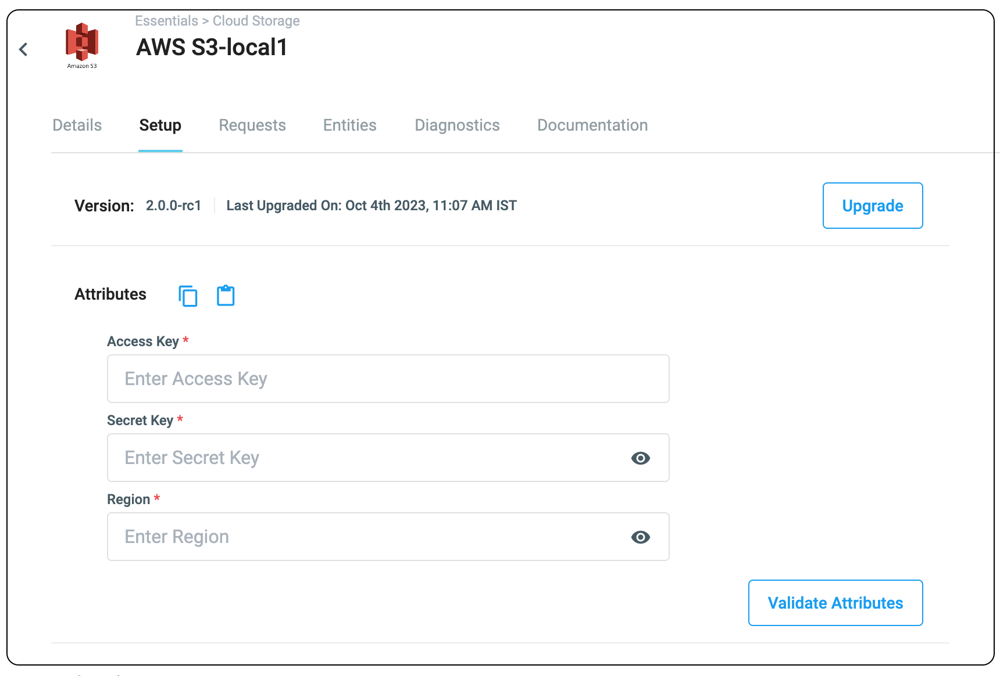

# Authentication

## Overview

The AWS S3 Extension uses **AWS Signature Version 4 (SigV4)** authentication to securely communicate with Amazon S3
services. This cryptographic authentication method ensures that all requests are verified for identity and integrity,
protecting your data from unauthorized access and tampering.

## AWS Signature Version 4 (SigV4)

### What is AWS Signature Version 4?

AWS Signature Version 4 is a protocol for authenticating requests to AWS services. It provides:

- **Identity Verification**: Confirms the requester's identity using AWS credentials
- **Request Integrity**: Ensures requests haven't been tampered with during transit
- **Replay Protection**: Prevents unauthorized reuse of valid requests
- **Secure Communication**: All requests are signed with your Secret Access Key

### How It Works

1. **Request Creation**: When you make a request to S3, the extension creates a canonical request
2. **String to Sign**: A string is created containing request details and timestamp
3. **Signature Calculation**: The string is signed using your Secret Access Key and region information
4. **Authorization Header**: The signature is added to the request's Authorization header
5. **AWS Verification**: AWS verifies the signature and processes the request if valid

### Authentication Flow

```
User Request → Extension → Create Canonical Request → Generate Signature
                                                              ↓
AWS S3 ← Verify Signature ← Add Authorization Header ← Sign with Secret Key
```

## Required Credentials

The extension requires three authentication parameters:

### 1. Access Key ID

- **Description**: Your IAM user's unique Access Key identifier
- **Format**: 20-character alphanumeric string
- **Example**: `REDACTED_SECRET`
- **Purpose**: Identifies which IAM user is making the request
- **Security**: Can be shared in logs and error messages (not sensitive)

### 2. Secret Access Key

- **Description**: Your IAM user's secret key for signing requests
- **Format**: 40-character alphanumeric string
- **Example**: `wJalrXUtnFEMI/K7MDENG/bPxRfiCYEXAMPLEKEY`
- **Purpose**: Used to cryptographically sign requests
- **Security**:  **Highly Sensitive** - Never share or expose this key

### 3. AWS Region

- **Description**: The geographic region where your S3 buckets are located
- **Format**: Region code (e.g., `us-east-1`, `eu-west-1`)
- **Example**: `us-east-1` for US East (N. Virginia)
- **Purpose**: Determines which AWS regional endpoint to use
- **Note**: Must match the region where your buckets exist or will be created

## Configuration Example



When configuring the extension, provide:

| Parameter      | Value                       | Description                     |
|----------------|-----------------------------|---------------------------------|
| **Access Key** | `REDACTED_SECRET`      | Your IAM user Access Key ID     |
| **Secret Key** | `wJalrXUtnFEMI/K7MDENG/...` | Your IAM user Secret Access Key |
| **Region**     | `us-east-1`                 | AWS region for your S3 buckets  |

## Security Best Practices

### 1. Credential Protection

- **Never commit** credentials to source control
- **Never share** your Secret Access Key
- **Store securely** in the Krista platform's secure configuration
- **Rotate regularly** (recommended every 90 days)
- **Use separate credentials** for different environments (dev, staging, production)

### 2. IAM User Permissions

Create a dedicated IAM user for the extension with **minimum required permissions**:

**Recommended Policy**: `AmazonS3FullAccess` (for full S3 operations)

**Custom Policy** (for restricted access):

```json
{
  "Version": "2012-10-17",
  "Statement": [
    {
      "Effect": "Allow",
      "Action": [
        "s3:PutObject",
        "s3:GetObject",
        "s3:DeleteObject",
        "s3:ListBucket",
        "s3:CopyObject",
        "s3:GetObjectAcl"
      ],
      "Resource": [
        "arn:aws:s3:::your-bucket-name/*",
        "arn:aws:s3:::your-bucket-name"
      ]
    }
  ]
}
```

### 3. Access Key Management

- **Create dedicated keys** for the extension (don't reuse personal keys)
- **Monitor usage** through AWS CloudTrail
- **Disable unused keys** immediately
- **Delete compromised keys** and generate new ones
- **Enable MFA** on the IAM user account when possible

### 4. Network Security

- All requests use **HTTPS** (TLS encryption)
- Requests are signed with **timestamp** to prevent replay attacks
- **Region-specific endpoints** ensure data stays in the correct geographic location

## Authentication Errors

### Common Authentication Issues

| Error                   | Cause                                    | Resolution                                          |
|-------------------------|------------------------------------------|-----------------------------------------------------|
| `InvalidAccessKeyId`    | Access Key is incorrect or doesn't exist | Verify Access Key in AWS IAM console                |
| `SignatureDoesNotMatch` | Secret Key is incorrect                  | Verify Secret Key is correct (regenerate if needed) |
| `InvalidToken`          | Credentials have expired or been revoked | Generate new Access Key and Secret Key              |
| `AccessDenied`          | IAM user lacks required permissions      | Attach appropriate S3 policies to IAM user          |
| `InvalidRequest`        | Region mismatch or invalid region code   | Verify region code matches bucket location          |

### Troubleshooting Steps

1. **Verify Credentials**:
    - Check Access Key and Secret Key for typos
    - Ensure no extra spaces or characters
    - Confirm credentials are active in AWS IAM

2. **Check Permissions**:
    - Verify IAM user has S3 permissions
    - Review attached policies
    - Check bucket policies don't restrict access

3. **Validate Region**:
    - Confirm region code is correct (e.g., `us-east-1`)
    - Ensure bucket exists in the specified region
    - Check region supports required S3 features

4. **Test Credentials**:
    - Use AWS CLI to test credentials: `aws s3 ls --profile your-profile`
    - Verify credentials work in AWS Console
    - Check AWS CloudTrail for authentication attempts

## Region-Specific Authentication

### Why Region Matters

AWS Signature Version 4 includes the region in the signature calculation. This means:

- Requests are **region-specific**
- You must specify the **correct region** where your buckets exist
- Cross-region requests require the **target region** to be specified

### Region Examples

| Use Case                 | Region Code      | Endpoint                          |
|--------------------------|------------------|-----------------------------------|
| US East (N. Virginia)    | `us-east-1`      | `s3.us-east-1.amazonaws.com`      |
| US West (Oregon)         | `us-west-2`      | `s3.us-west-2.amazonaws.com`      |
| EU (Ireland)             | `eu-west-1`      | `s3.eu-west-1.amazonaws.com`      |
| Asia Pacific (Singapore) | `ap-southeast-1` | `s3.ap-southeast-1.amazonaws.com` |

**Example**: If your bucket is in **US East (N. Virginia)**, configure the extension with region `us-east-1`.

## Next Steps

1. **Create IAM User**: Follow [Creating AWS User](/pages/CreatingAWSUser.md) to set up credentials
2. **Configure Extension**: See [Extension Configuration](/pages/ExtensionConfiguration.md) for setup
3. **Test Connection**: Use a simple catalog request to verify authentication

## See Also

- [Extension Configuration](/pages/ExtensionConfiguration.md) - Setup and configuration guide
- [Creating AWS User](/pages/CreatingAWSUser.md) - IAM user creation steps
- [AWS Signature Version 4 Documentation](https://docs.aws.amazon.com/general/latest/gr/signature-version-4.html)
- [AWS IAM Best Practices](https://docs.aws.amazon.com/IAM/latest/UserGuide/best-practices.html)


